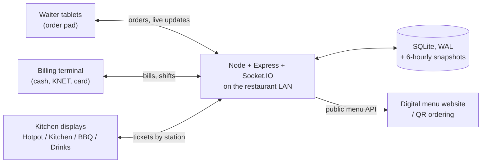

# Restaurant POS and Kitchen Display (case study)

A real-time, multi-terminal point of sale and kitchen display system I designed and built, as the
sole developer, for Eastern Palace, a Chinese hotpot restaurant in Kuwait. Waiters order from any
tablet on the restaurant network, the kitchen sees tickets on station screens, and one billing
terminal settles bills and runs the cash drawer.

> The source code belongs to the client, so this repository holds the write-up only. I am happy to
> walk through the code and a local demo on a call.

## At a glance

| | |
|---|---|
| Role | Sole developer: requirements with the owners, design, build, deployment |
| Server | Node.js, Express, Socket.IO, SQLite (better-sqlite3, WAL mode), runs on the restaurant LAN |
| Client | React + Vite, served by the same server; works in any browser on any tablet |
| Size | 8 screens, 6 API route groups, 18-table schema |
| Ops | PM2 supervision, automatic database snapshots on start and every 6 hours |

## Architecture

## Features

- **Floor plan:** editable indoor and outdoor table map, plus takeaway tabs
- **Order pad:** hotpot ordering (soup bases plus per-ingredient items, added to mid-meal) and the standard
  kitchen menu, English and Chinese item names, out-of-stock handling
- **Kitchen display:** tickets routed by station and moved through placed, preparing, ready, served in
  real time; each "send to kitchen" is its own timed ticket so mid-meal additions show up as new chits
- **Billing:** running tabs, promotions, audited manual discounts, split tender across Cash, KNET and Card,
  80 mm thermal receipts, bill history with reprint, reopen and refund behind a manager PIN
- **Shifts and cash:** opening float, cash in and out with reasons, close-of-shift Z-report comparing
  expected and counted cash; bills can only be settled while a shift is open
- **Table operations:** move and merge tabs, audited
- **Admin:** owner-editable menu and prices in English, Chinese and Arabic (right to left), floor plan,
  staff PINs by role, promotions, tax and service settings
- **Reports:** daily sales, payment-method breakdown, best sellers, category mix, audit log
- **Public menu API:** live trilingual menu and prices for the restaurant's digital menu and QR ordering

## Problems worth talking about

**Restaurant Wi-Fi is unreliable.** A tablet can send an order, lose the response and retry. Order
submission is idempotent, so a retry never creates a duplicate ticket or a double charge.

**Money without rounding errors.** Kuwaiti dinar has three decimals. Every amount is stored and summed as
integer fils (1 KD = 1000 fils), so totals, discounts and split payments always add up exactly.

**Getting the business day right.** Bills after midnight still belong to the right trading day; all
timestamps are Kuwait local time on receipts, reports and in the database.

**Hotpot is not a normal menu.** Guests keep adding ingredients through the meal. Modelling each send as
its own ticket lets the kitchen see exactly what is new, while the bill keeps one running tab.

**No data loss on a single machine.** SQLite in WAL mode handles concurrent tablets, PM2 restarts the
server if it crashes, and the database is snapshotted every 6 hours (last 30 kept) to a synced folder.

**Decisions the owners had not made yet.** Payment methods, tax and service percentages, promotions and
the floor map are all settings rather than code, and the payments table is ready for a KNET gateway
(MyFatoorah, Tap or UPayments) without a schema change.

## Contact

Fatima Salahuddin, BS Computer Science, FAST-NUCES Karachi
[Profile](https://github.com/fatima-salahuddin) · [LinkedIn](https://www.linkedin.com/in/fatima-salahuddin-/) · fatimasalahuddinmirza@gmail.com
